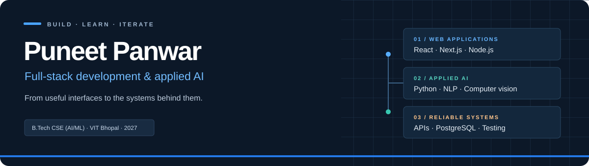

  

<h1 align="center">Hi, I'm Puneet 👋</h1>

  <strong>Computer Science student building web applications and applied AI projects.</strong> 
  B.Tech CSE (AI &amp; Machine Learning) · VIT Bhopal · Class of 2027

  <a href="https://puneet-portfolio-psi.vercel.app/"><strong>Portfolio ↗</strong></a>
  &nbsp; · &nbsp;
  <a href="https://www.linkedin.com/in/puneet-panwar"><strong>LinkedIn ↗</strong></a>
  &nbsp; · &nbsp;
  <a href="https://github.com/Puneet-3?tab=repositories"><strong>All projects ↗</strong></a>

---

## What I build

I enjoy taking a practical problem from the interface through the API, database, and tests. My projects span digital wallets, healthcare software, language classification, and computer vision.

- **Full-stack applications** — React and Next.js interfaces backed by Node.js or Python services.
- **Applied AI** — NLP and computer vision projects with documented scope and limitations.
- **Backend engineering** — authentication, data integrity, reliable payment retries, and concurrency testing.

## Selected projects

<table>
<tr>
<td width="50%" valign="top">

### [PayFlow](https://github.com/Puneet-3/PayFlow)
**Digital wallet & P2P payment simulator**

A banking-style interface for balances, deposits, transfers, and transaction history. PostgreSQL transactions, ordered row locks, and idempotency keys protect payment updates and retries.

**React · Node.js · Express · PostgreSQL**

[Open preview ↗](https://payflow-git-deploy-vercel-preview-puneet-s-projects46.vercel.app) · [Explore the project →](https://github.com/Puneet-3/PayFlow#readme)

</td>
<td width="50%" valign="top">

### [MedAI](https://github.com/Puneet-3/MedAI-Platform)
**Experimental healthcare software**

Patient, doctor, and administrator workspaces with symptom checks, private report access, and authenticated text consultations. Includes experimental chest X-ray screening with a documented model evaluation.

**Next.js · TypeScript · FastAPI · PostgreSQL**

[Explore the project →](https://github.com/Puneet-3/MedAI-Platform#readme)

</td>
</tr>
<tr>
<td width="50%" valign="top">

### [Sarkari Scam Detector](https://github.com/Puneet-3/sarkari-scam-detector)
**Government-scheme message classification**

Checks suspicious messages in Hindi, Hinglish, and English. Includes individual message analysis, CSV processing, and a Flask dashboard.

**Python · Flask · Machine learning · NLP**

[Explore the project →](https://github.com/Puneet-3/sarkari-scam-detector#readme)

</td>
<td width="50%" valign="top">

### [Voice Cart](https://github.com/Puneet-3/voice-shopping-assistant)
**Voice-driven shopping assistant**

A shopping cart and inventory interface with natural-language commands, quantity parsing, product search, and contextual suggestions.

**JavaScript · Express · Web Speech API**

[Explore the project →](https://github.com/Puneet-3/voice-shopping-assistant#readme)

</td>
</tr>
<tr>
<td width="50%" valign="top">

### [Stock Trading Platform](https://github.com/Puneet-3/stock-trading-platform)
**Full-stack trading simulation**

A MERN application inspired by stock-trading workflows, with authentication, a dashboard, simulated orders, and portfolio tracking.

**React · Node.js · Express · MongoDB**

[Explore the project →](https://github.com/Puneet-3/stock-trading-platform#readme)

</td>
<td width="50%" valign="top">

### [Real-Time Posture Detection](https://github.com/Puneet-3/Real_Time_Posture_Detection_System)
**Computer vision for desk posture**

Uses webcam landmarks and joint angles to identify sustained poor sitting posture and provide feedback.

**Python · OpenCV · MediaPipe**

[Explore the project →](https://github.com/Puneet-3/Real_Time_Posture_Detection_System#readme)

</td>
</tr>
</table>

*PayFlow uses simulated funds. MedAI is a learning project; its models have not been clinically validated.*

## Tools I work with

  
  
  
  
  
  
  

| Area | Technologies |
| --- | --- |
| Frontend | React, Next.js, JavaScript, TypeScript, HTML, CSS |
| Backend & data | Node.js, Express, FastAPI, Flask, PostgreSQL, MongoDB, Supabase |
| AI & computer vision | Python, PyTorch, scikit-learn, OpenCV, MediaPipe |
| Development | Git, GitHub, Docker, Vercel |

## Currently improving

- Building out PayFlow and testing its complete user journey.
- Strengthening my understanding of database transactions, API design, and system design.
- Making my projects easier to run, test, and explain through better documentation.

## More explorations

[Eco-Loop Building Agents](https://github.com/Puneet-3/eco-loop-building-agents) ·
[Fake News Detection](https://github.com/Puneet-3/Fake_News_Detection_BERT) ·
[Nintendo Switch Chatbox](https://github.com/Puneet-3/nintendo-switch-chatbox) ·
[Human Pose Estimation](https://github.com/Puneet-3/human-pose-estimation-using-machine-learning)

---

  Interested in how something works? Open a project, explore the code, and take a look at its README. 
  <a href="https://www.linkedin.com/in/puneet-panwar">Let's connect on LinkedIn.</a>

